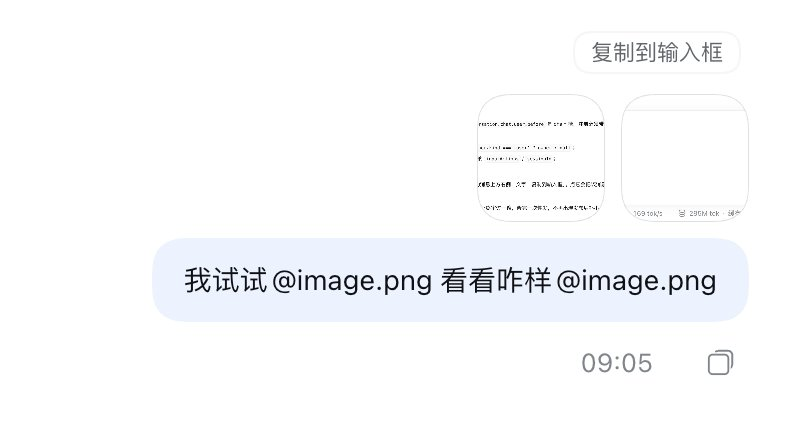

# dsh-inline-attachments（输入框图片与文件）

**在输入框里把图/文件放在哪里，模型就在哪个位置读到它——不用再写“如图 1、图 2 等等”。**




## 怎么用

在输入框里粘贴、拖入或点 + 选择图片/文件，它会自动变成一个带文件名的小标签（不是链接）；发送时模型就在这个位置读它。

删掉正文小标签会一起删附件；点图片标签看大图，点文件标签打开/下载。鼠标放在标签上，上方对应缩略图会描边。发送后，消息文本里会保留 `@文件名`，图片出现在同一位置；模型同时看到名字和图片。重开 DSH 后，草稿里的图需要重新贴一次。

已发送的用户消息上方有「复制到输入框」：把该消息的文本和图片恢复成草稿。原型限制：图片先追加到末尾，原句位置/多图顺序不保证完全还原；PDF/Excel/视频/音频等文件暂不复制（等 DSH 开放附件重挂接口）。

## 安装

在 DSH Desktop 打开「插件 → 添加插件」，输入 `dsh-inline-attachments`；或：

```sh
dsh plugin --profile desktop add dsh-inline-attachments
```

市场收录后也可以搜「行内附件」。

从源码开发/安装：见 [PUBLISHING.md](https://github.com/Panther-w/dsh-inline-attachments/blob/main/PUBLISHING.md)。

## 卸载

在 DSH 的插件页卸载（或禁用）`dsh-inline-attachments`，重启 DSH 即恢复原样。

## 验证

```bash
# Node 22+
node --test test/host.test.mjs test/client-load.test.mjs test/host-wiring.test.mjs test/client-flow.test.mjs
# 或 npm test
```

28 个自动测试 + 多轮人工测试（粘贴/拖入、删图/撤销、焦点、悬浮描边、文件标签、亮/暗主题）。

## 状态

0.1.3。早期版本，依赖 DSH 输入框的内部接口，DSH 以后升级可能需要跟着改。

亮/暗主题跟随 DSH；Windows 没有平台相关代码，但没有在 Windows 真机实测。

## English

**Put images/files where you mean them — the model reads them in that exact position. No more “see image 1 / image 2”.**

Paste, drop, or upload an image/file; it becomes a small label in the composer. On send, the model reads each file where you put it. Version 0.1.0 relies on composer internals. Light/dark themes follow DSH; Windows is untested.

MIT · repo `Panther-w/dsh-inline-attachments` · 27 automated tests + manual testing.
